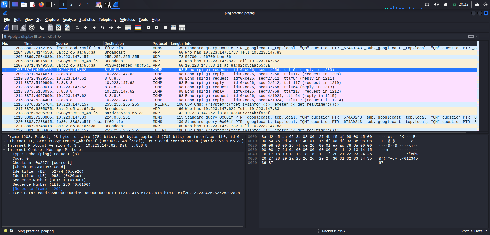
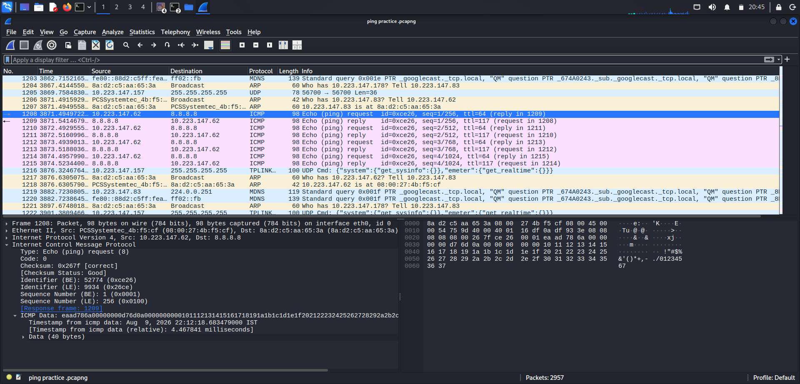
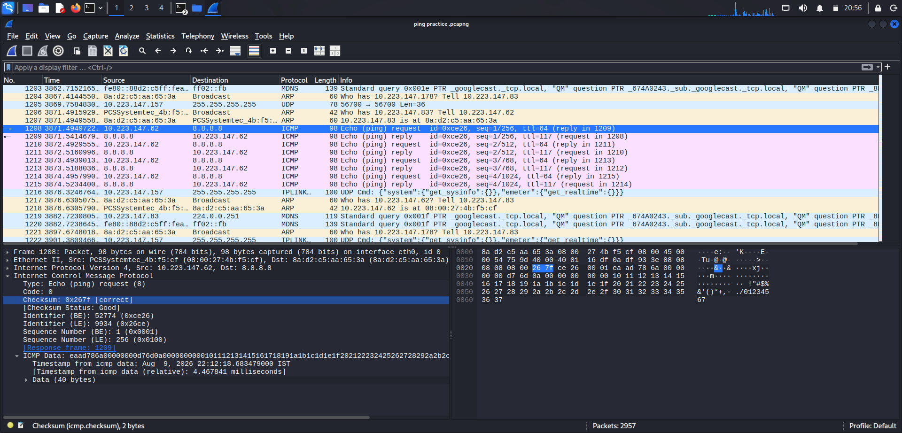

# ICMP Ping Traffic Analysis using Wireshark

## 📌 Project Overview

This project demonstrates the capture and analysis of ICMP
Echo Request and Echo Reply packets using Wireshark.

The goal of this project is to understand how a ping operation
works at the packet level and to analyse the important fields
inside an ICMP packet.

## 🎯 Objectives

- Understand how ICMP ping works
- Capture ICMP traffic using Wireshark
- Analyse Echo Request and Echo Reply packets
- Understand ICMP Type and Code
- Analyse Identifier and Sequence Number
- Examine IPv4 fields such as Source IP, Destination IP and TTL
- Understand the relationship between request and reply packets

## 🧪 Lab Environment

- Operating System: Kali Linux
- Tool: Wireshark
- Network Interface: eth0
- Target: 8.8.8.8 (Google DNS)
- Protocol: ICMP
- Command used: ping -c 4 8.8.8.8
- Capture file: ping practice .pcapng

## 🔬 Experiment

### 1. Generate ICMP Traffic

First, we opened the terminal in Kali Linux and used the following command:

```bash
ping -c 4 8.8.8.8

```

This sends an ICMP Echo Request packet to 8.8.8.8.

If the target receives the request, it sends an ICMP Echo Reply back to our system.

### 2. Capture the Packets

We opened Wireshark and selected the `eth0` interface.

Then we started capturing the network traffic while the ping command was running.

Wireshark captured the ICMP Echo Request and Echo Reply packets.

### 3. Filter ICMP Packets

After capturing the traffic, we used the following filter in Wireshark:

```text
icmp
```

This filter shows only ICMP packets in the capture.

We can see both Echo Request and Echo Reply packets.

## 📦 Packet Analysis

We selected an ICMP Echo Request packet in Wireshark and checked the details inside the packet.

The main fields we looked at were:

- Type
- Code
- Checksum
- Identifier
- Sequence Number
- Source IP
- Destination IP
- TTL
- ICMP Data

### 1. ICMP Echo Request

The Echo Request is the packet sent from our Kali Linux system to 8.8.8.8.

In our capture:

- Source IP: 10.223.147.62
- Destination IP: 8.8.8.8
- Protocol: ICMP
- Type: 8
- Code: 0

Type 8 means the packet is an ICMP Echo Request.

This is the request sent by the ping command to check if the destination is reachable.

### 2. ICMP Echo Reply

The Echo Reply is the response sent back from 8.8.8.8 to our Kali Linux system.

In our capture:

- Source IP: 8.8.8.8
- Destination IP: 10.223.147.62
- Protocol: ICMP
- Type: 0
- Code: 0

Type 0 means the packet is an ICMP Echo Reply.

The reply shows that 8.8.8.8 received our Echo Request and sent a response back.

Kali → 8.8.8.8
      Echo Request
      Type 8

8.8.8.8 → Kali
          Echo Reply
          Type 0

### 3. ICMP Type and Code

ICMP uses Type and Code fields to describe the message.

For our ping request:

- Type: 8
- Code: 0

Type 8 means Echo Request.

For the reply:

- Type: 0
- Code: 0

Type 0 means Echo Reply.

The Code value gives more specific information about the ICMP Type. For Echo Request and Echo Reply, Code 0 is used.

Request → Type 8, Code 0
Reply   → Type 0, Code 0

### 4. Identifier

The Identifier is a number used to associate ICMP Echo Requests and Replies with the same ping process or exchange.

In our packet, the Identifier was:

- Identifier: 52774 (0xce26)

The same Identifier can be seen in the corresponding Echo Reply.

Identifier = 52774

Request → 52774
Reply   → 52774

### 5. Sequence Number

The Sequence Number helps us identify the order of the ICMP Echo Requests.

In our capture, the first request had:

- Sequence Number: 1

The next requests used higher sequence numbers.

The corresponding Echo Reply uses the same Sequence Number as the request. This helps us match a reply with its request.

Request 1 → Sequence 1
Reply 1   → Sequence 1

Request 2 → Sequence 2
Reply 2   → Sequence 2


### 6. Time to Live (TTL)

TTL is a value in the IPv4 header that limits how many routers can forward a packet.

In our Echo Request packet, the TTL value was:

- TTL: 64

Each router that forwards the packet normally decreases the TTL by 1.

This helps prevent packets from staying in the network forever if there is a routing problem.

Simple example:-

Kali
TTL = 64
 ↓
Router
TTL = 63
 ↓
Router
TTL = 62
 ↓
...


### 7. Source and Destination IP

The Source IP shows where the packet came from, and the Destination IP shows where the packet is going.

For our Echo Request:

- Source IP: 10.223.147.62
- Destination IP: 8.8.8.8

For the Echo Reply, the addresses are reversed:

- Source IP: 8.8.8.8
- Destination IP: 10.223.147.62

This shows the direction of the request and reply packets.

Simple Flow :-

Echo Request:
10.223.147.62 → 8.8.8.8

Echo Reply:
8.8.8.8 → 10.223.147.62

### 8. ICMP Data

The ICMP packet also contains data along with the ICMP header.

In our capture, Wireshark showed a timestamp and additional data bytes inside the ICMP Data section.

The data is carried with the Echo Request and is normally copied into the Echo Reply.

This helps the sender check that the data sent in the request was received and returned correctly.

## 🔄 Request and Reply Relationship

The ping process works by sending an ICMP Echo Request and waiting for an ICMP Echo Reply.

In our capture, we could see this communication between our system and 8.8.8.8.

```text
Kali Linux → 8.8.8.8
ICMP Echo Request
Type 8, Code 0

8.8.8.8 → Kali Linux
ICMP Echo Reply
Type 0, Code 0

## 📸 Screenshots

### 1. Wireshark Packet Capture

This screenshot shows the ICMP packets captured in Wireshark.


### 2. ICMP Echo Request

This screenshot shows the ICMP Echo Request packet from our Kali Linux system to 8.8.8.8.



### 3. ICMP Echo Reply

This screenshot shows the ICMP Echo Reply packet from 8.8.8.8 back to our Kali Linux system.


### 4. ICMP Data

This screenshot shows the data carried inside the ICMP Echo Request packet.



### 5. ICMP Checksum

This screenshot shows the checksum field inside the ICMP packet.




## 📁 Project Structure

```text
ICMP-Ping-Wireshark-Analysis/
├── captures/
│   └── ping practice .pcapng
├── screenshots/
│   ├── 01-wireshark-capture.png
│   ├── 02-icmp-echo-request.png
│   ├── 03-icmp-echo-reply.png
│   ├── 04-icmp-data.png
│   └── 05-icmp-checksum.png
└── README.md


## 🧠 Key Learnings

Through this project, I learned:

- How ICMP works during a ping operation
- How to capture network traffic using Wireshark
- How to identify Echo Request and Echo Reply packets
- How ICMP Type and Code identify different messages
- How Identifier and Sequence Number help match requests and replies
- How Source IP and Destination IP show packet direction
- How TTL limits packet forwarding across networks
- How ICMP carries data inside the packet
- How the ICMP checksum is used to detect errors in the ICMP message
- How packet analysis can help understand network communication

## 🚀 Conclusion

This project helped me understand what happens behind a simple ping command.

Instead of only seeing a successful ping response in the terminal, I analysed the actual packets using Wireshark and understood the important fields inside them.

This gave me practical experience with network traffic analysis and basic packet-level troubleshooting.

It is also my first practical cybersecurity project and will be used as part of my cybersecurity portfolio.
