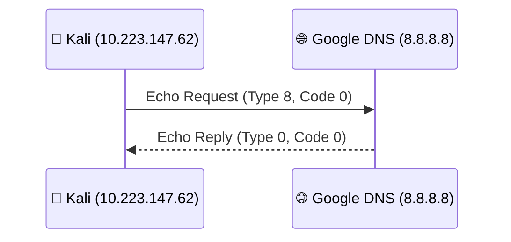
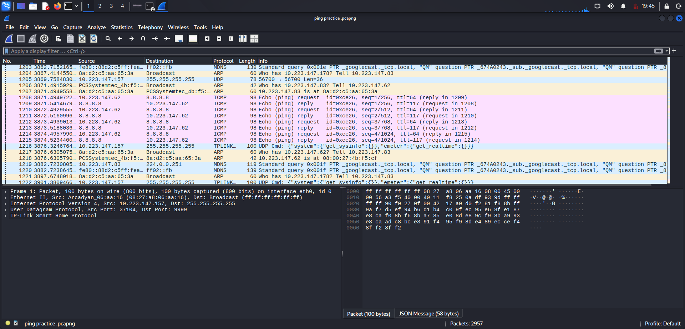
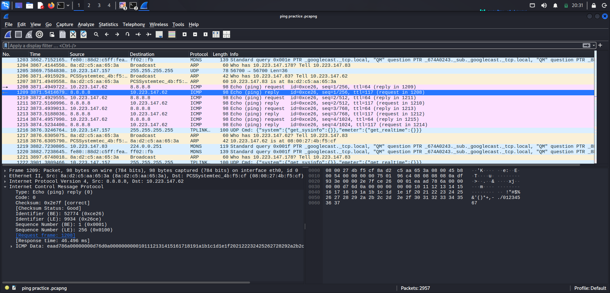
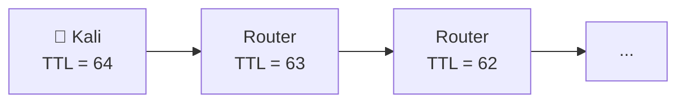

# 🏓 What Really Happens When You Type `ping`?

### A packet-level look at ICMP using Wireshark

> I ran `ping -c 4 8.8.8.8`, captured every packet, and took them apart field by field.
> This is my lab notebook.

**Tools:** `Wireshark` · `Kali Linux` · `ICMP` · `IPv4`  |  **Level:** Beginner  |  **Type:** Packet analysis lab

---

## 🗒️ Lab card

| | |
|---|---|
| **Operating system** | Kali Linux |
| **Tool** | Wireshark |
| **Interface** | `eth0` |
| **Target** | `8.8.8.8` (Google DNS) |
| **Protocol** | ICMP |
| **Command** | `ping -c 4 8.8.8.8` |
| **Capture file** | [`ping-practice.pcapng`](./captures/ping-practice.pcapng) |

## 🎯 What I wanted to learn

- [x] How ICMP ping works
- [x] How to capture ICMP traffic using Wireshark
- [x] How to analyse Echo Request and Echo Reply packets
- [x] What ICMP Type and Code mean
- [x] How Identifier and Sequence Number work
- [x] What IPv4 fields like Source IP, Destination IP and TTL show
- [x] How a request and its reply relate to each other

---

## 🧭 The big picture



Ping sends an ICMP **Echo Request** and waits for an ICMP **Echo Reply**. If the reply comes back, the target is reachable.

---

## 🔬 Step 1: Make some noise

Open a terminal in Kali Linux and run:

```bash
ping -c 4 8.8.8.8
```

This sends ICMP Echo Request packets to `8.8.8.8`. If the target receives a request, it sends an Echo Reply back to our system.

## 🎣 Step 2: Capture it

Open Wireshark, select the **`eth0`** interface and start capturing while the ping runs. Wireshark picks up both the Echo Request and Echo Reply packets.

## 🔍 Step 3: Filter the noise

Apply this display filter:

```text
icmp
```

Now only ICMP packets are shown, with both Echo Requests and Echo Replies visible.



---

## 🧬 Dissecting the packets

I selected an Echo Request and inspected what's inside. The fields I focused on:

`Type` · `Code` · `Checksum` · `Identifier` · `Sequence Number` · `Source IP` · `Destination IP` · `TTL` · `ICMP Data`

### 🟦 The request

The Echo Request goes from my Kali system to `8.8.8.8`. It is the packet `ping` sends to check if the destination is reachable.

| Field | Value |
|---|---|
| Source IP | `10.223.147.62` |
| Destination IP | `8.8.8.8` |
| Protocol | ICMP |
| **Type** | **8** (Echo Request) |
| **Code** | **0** |


### 🟩 The reply

The Echo Reply comes back from `8.8.8.8`. It proves the target received my request and responded.

| Field | Value |
|---|---|
| Source IP | `8.8.8.8` |
| Destination IP | `10.223.147.62` |
| Protocol | ICMP |
| **Type** | **0** (Echo Reply) |
| **Code** | **0** |



---

## 🔎 Field by field

### 1️⃣ Type and Code: *what kind of message is this?*

ICMP uses **Type** and **Code** to describe the message. The Code gives more specific information about the Type. For Echo Request and Echo Reply, Code 0 is used.

```text
Request → Type 8, Code 0
Reply   → Type 0, Code 0
```

### 2️⃣ Identifier: *which ping does this belong to?*

The Identifier associates Echo Requests and Replies with the **same ping process or exchange**.

In my capture it was **`52774` (`0xce26`)**, and the same value appeared in the matching Echo Reply.

```text
Request → Identifier 52774
Reply   → Identifier 52774
```

### 3️⃣ Sequence Number: *which one in the series?*

The Sequence Number shows the **order** of the Echo Requests. My first request had Sequence Number `1`, and the following requests used higher numbers.

The reply copies the same Sequence Number as its request, which is how a reply is matched to its request.

```text
Request 1 → Sequence 1      Reply 1 → Sequence 1
Request 2 → Sequence 2      Reply 2 → Sequence 2
```

### 4️⃣ TTL: *how long can this packet live?*

TTL (Time to Live) is an IPv4 header value that limits how many routers can forward a packet. My Echo Request had **TTL = 64**.

Each router that forwards the packet normally decreases the TTL by 1. This prevents packets from circulating in the network forever if there is a routing problem.



### 5️⃣ Source and Destination IP: *who is talking to whom?*

The Source IP shows where the packet came from; the Destination IP shows where it is going. In the reply, the addresses are **reversed**.

```text
Echo Request:  10.223.147.62 → 8.8.8.8
Echo Reply:    8.8.8.8 → 10.223.147.62
```

### 6️⃣ ICMP Data: *what's riding along?*

The ICMP packet carries data along with its header. In my capture, Wireshark showed a **timestamp and additional data bytes** in the ICMP Data section.

The data travels with the Echo Request and is normally copied into the Echo Reply. This lets the sender check that what it sent was received and returned correctly.


### 7️⃣ Checksum: *is the message intact?*

The ICMP checksum is used to **detect errors** in the ICMP message.


---

## 🧾 Cheat sheet

| Field | What I saw | What it means |
|---|---|---|
| Type | 8 → 0 | Echo Request → Echo Reply |
| Code | 0 | Used for both Echo Request and Echo Reply |
| Identifier | `52774` (`0xce26`) | Same in request and reply, ties them to one ping |
| Sequence Number | `1`, `2`, ... | Order of requests; reply copies it |
| TTL | 64 | Limits router hops; drops by 1 per router |
| Source / Destination IP | `10.223.147.62` ↔ `8.8.8.8` | Swapped in the reply |
| ICMP Data | Timestamp + data bytes | Sent in request, copied in reply |
| Checksum | Present in header | Detects errors in the ICMP message |

---

## 🧠 What I took away

- How ICMP works during a ping operation
- How to capture network traffic using Wireshark
- How to identify Echo Request and Echo Reply packets
- How ICMP Type and Code identify different messages
- How Identifier and Sequence Number help match requests and replies
- How Source IP and Destination IP show packet direction
- How TTL limits packet forwarding across networks
- How ICMP carries data inside the packet
- How the ICMP checksum detects errors in the ICMP message
- How packet analysis helps in understanding network communication

## 🚀 Conclusion

This project helped me understand what happens behind a simple ping command.

Instead of only seeing a successful reply in the terminal, I analysed the actual packets in Wireshark and understood the important fields inside them. It gave me practical experience with **network traffic analysis and basic packet-level troubleshooting**.

> 🌱 This is my **first practical cybersecurity project**, and it is part of my cybersecurity portfolio.

---

## 📁 Repository layout

```text
ICMP-Ping-Wireshark-Analysis/
├── captures/
│   └── ping-practice.pcapng
├── screenshots/
│   ├── 01-wireshark-capture.png
│   ├── 02-icmp-echo-request.png
│   ├── 03-icmp-echo-reply.png
│   ├── 04-icmp-data.png
│   └── 05-icmp-checksum.png
└── README.md
```

<sub>Open `ping-practice.pcapng` in Wireshark to explore the capture yourself.</sub>
